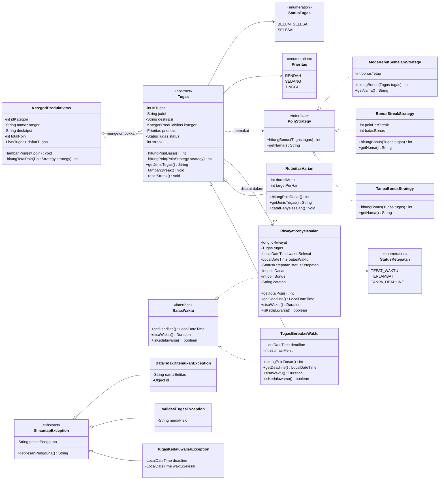

# Class Diagram SIMANTAP

Rancangan awal (Minggu 9) yang diperbarui pada Minggu 10. Diagram sumber ada di
`docs/class-diagram.mmd`; pratinjau Mermaid dapat dibuka langsung di Visual Studio
Code (ekstensi Markdown Preview Mermaid Support).

## Penjelasan Relasi

| Relasi | Jenis | Alasan |
|---|---|---|
| `KategoriProduktivitas` ke `Tugas` | agregasi `1..0..*` | Kategori mengelompokkan tugas, tetapi tugas tetap bermakna bila kategori diganti. |
| `Tugas` ke `RiwayatPenyelesaian` | asosiasi `1..0..*` | Satu tugas dapat diselesaikan berulang kali (khususnya rutinitas), dan setiap penyelesaian menghasilkan satu baris riwayat. |
| `Tugas` ke `PoinStrategy` | dependency | `Tugas` memakai strategi bonus tanpa mengetahui implementasinya. |
| `SimantapException` ke tiga exception | generalisasi | Memenuhi syarat satu exception induk dengan minimal tiga turunan. |

## Keputusan Rancangan

1. **`Tugas` abstract** menyimpan state bersama dan memaksa setiap turunan
   mengimplementasikan `hitungPoinDasar()`. Perhitungan poin berbeda:
   - `TugasBerbatasWaktu`: mempertimbangkan prioritas dan estimasi menit.
   - `RutinitasHarian`: mempertimbangkan durasi dan target harian.
2. **Polimorfisme** terjadi saat loop `for (Tugas t : daftar) t.hitungPoin(strategy)`.
   Tidak ada `instanceof` di dalam loop.
3. **`BatasWaktu`** dipasang pada dua kelas yang benar-benar membutuhkannya:
   `TugasBerbatasWaktu` (deadline aktif) dan `RiwayatPenyelesaian` (snapshot
   deadline untuk audit keterlambatan). `RutinitasHarian` tidak dipasangi
   interface ini karena tidak memiliki deadline.
4. **`RiwayatPenyelesaian` menyimpan `batasWaktu`** agar status tepat waktu dapat
   dihitung ulang meskipun data tugas berubah di kemudian hari.
5. **Strategy Pattern** memisahkan variasi bonus (tanpa bonus, bonus streak,
   mode kebut semalam) dari kelas tugas. Ini mencegah `if/switch` yang terus
   bertambah saat aturan bonus baru muncul.
6. **Single Table Inheritance**: `Tugas`, `TugasBerbatasWaktu`, dan
   `RutinitasHarian` dipetakan ke satu tabel `tugas` dengan diskriminator
   `jenis_tugas`. Kolom khusus turunan dibuat `NULL` untuk jenis yang tidak
   memakainya, dan `CHECK` menjaga agar kombinasi kolom tetap valid.

## Pemetaan ke Tabel

| Kelas | Tabel | Kolom pembeda |
|---|---|---|
| `KategoriProduktivitas` | `kategori_produktivitas` | `id_kategori` |
| `Tugas` | `tugas` | kolom umum |
| `TugasBerbatasWaktu` | `tugas` | `jenis_tugas = 'BERBATAS_WAKTU'`, `deadline` |
| `RutinitasHarian` | `tugas` | `jenis_tugas = 'RUTINITAS_HARIAN'`, `durasi_menit`, `target_per_hari` |
| `RiwayatPenyelesaian` | `riwayat_penyelesaian` | `batas_waktu` sebagai snapshot deadline |
